# Mermaid-heavy document (M4)

## Diagram 1

The value converges quickly. This follows from the lemma. Consider the general case. The value converges quickly. We now look at the bound.

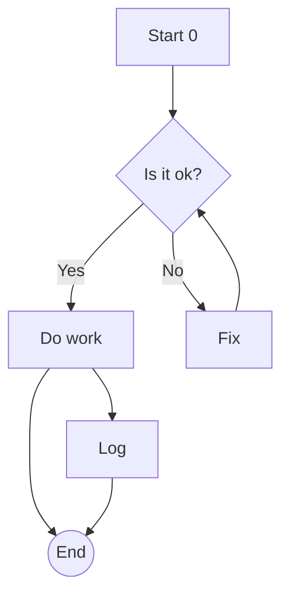

The value converges quickly. Note that the series is absolutely convergent. Consider the general case. We now look at the bound. Consider the general case. The value converges quickly.

## Diagram 2

Note that the series is absolutely convergent. Note that the series is absolutely convergent. The value converges quickly.

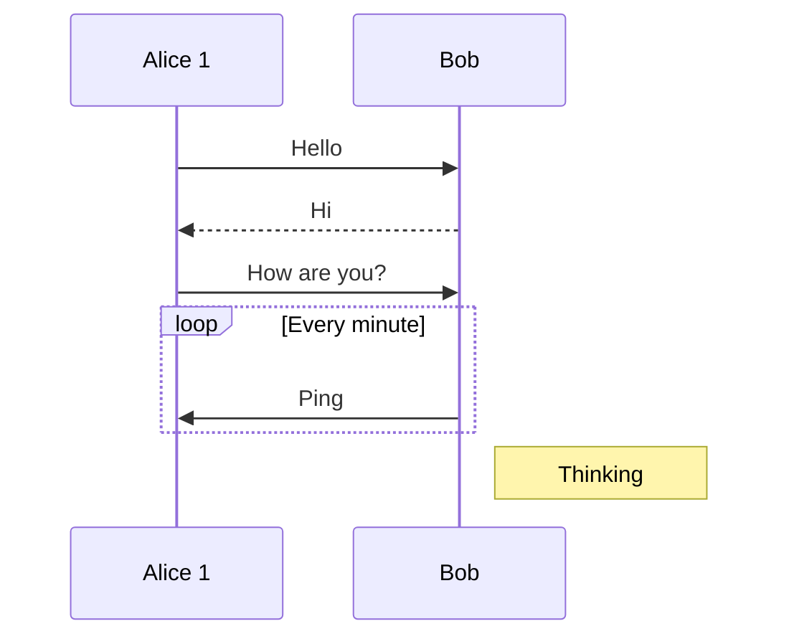

Note that the series is absolutely convergent. A short calculation gives the result. We now look at the bound. A short calculation gives the result. We now look at the bound. This follows from the lemma.

## Diagram 3

A short calculation gives the result. This follows from the lemma. With **strong** and *emphasis* text and `code $x$ here`. We now look at the bound. We now look at the bound.

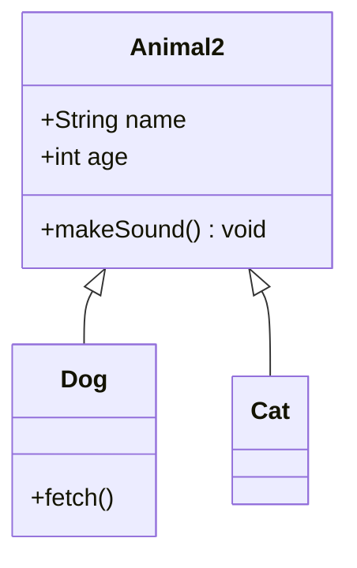

The value converges quickly. This follows from the lemma. This follows from the lemma. This follows from the lemma. A short calculation gives the result.

## Diagram 4

The value converges quickly. A short calculation gives the result. A short calculation gives the result. With **strong** and *emphasis* text and `code $x$ here`. We now look at the bound.

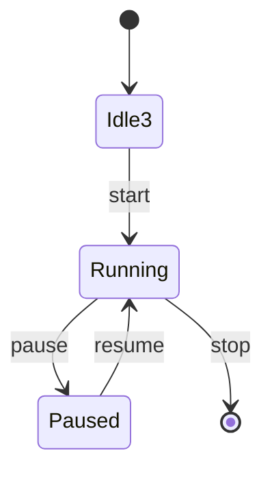

A short calculation gives the result. With **strong** and *emphasis* text and `code $x$ here`. Consider the general case. With **strong** and *emphasis* text and `code $x$ here`.

## Diagram 5

We now look at the bound. The value converges quickly. Note that the series is absolutely convergent. This follows from the lemma. The value converges quickly.


Consider the general case. This follows from the lemma. The value converges quickly.

## Diagram 6

This follows from the lemma. We now look at the bound. With **strong** and *emphasis* text and `code $x$ here`. We now look at the bound. We now look at the bound.

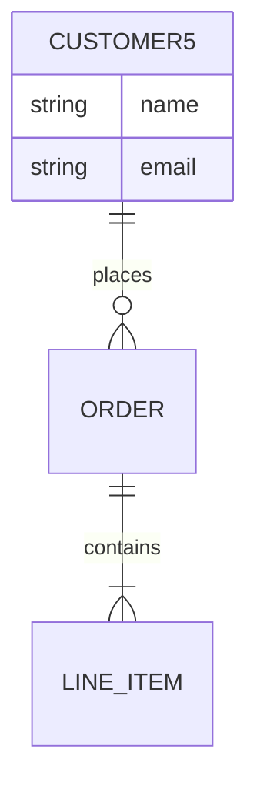

Consider the general case. Note that the series is absolutely convergent. This follows from the lemma. With **strong** and *emphasis* text and `code $x$ here`.

## Diagram 7

With **strong** and *emphasis* text and `code $x$ here`. With **strong** and *emphasis* text and `code $x$ here`. We now look at the bound. A short calculation gives the result. The value converges quickly. We now look at the bound.

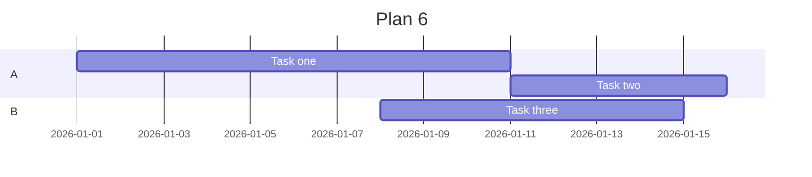

With **strong** and *emphasis* text and `code $x$ here`. Consider the general case. The value converges quickly. Note that the series is absolutely convergent. We now look at the bound. Consider the general case.

## Diagram 8

With **strong** and *emphasis* text and `code $x$ here`. Consider the general case. With **strong** and *emphasis* text and `code $x$ here`.

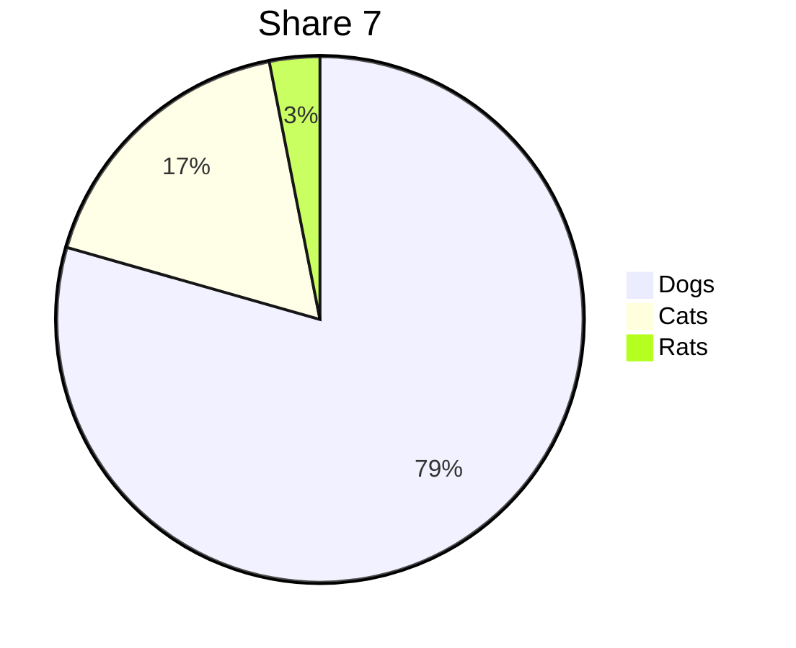

Consider the general case. A short calculation gives the result. The value converges quickly. A short calculation gives the result. This follows from the lemma. We now look at the bound.

## Diagram 9

With **strong** and *emphasis* text and `code $x$ here`. The value converges quickly. The value converges quickly. This follows from the lemma. Note that the series is absolutely convergent.


This follows from the lemma. A short calculation gives the result. Note that the series is absolutely convergent. A short calculation gives the result. We now look at the bound.

## Diagram 10

A short calculation gives the result. A short calculation gives the result. A short calculation gives the result.

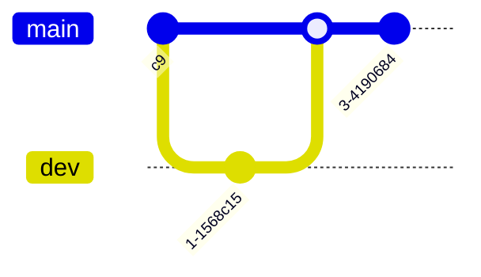

Consider the general case. This follows from the lemma. The value converges quickly. The value converges quickly.

## Diagram 11

Note that the series is absolutely convergent. This follows from the lemma. The value converges quickly. This follows from the lemma.


With **strong** and *emphasis* text and `code $x$ here`. With **strong** and *emphasis* text and `code $x$ here`. Note that the series is absolutely convergent. A short calculation gives the result.

## Diagram 12

We now look at the bound. Note that the series is absolutely convergent. We now look at the bound. Consider the general case. A short calculation gives the result.

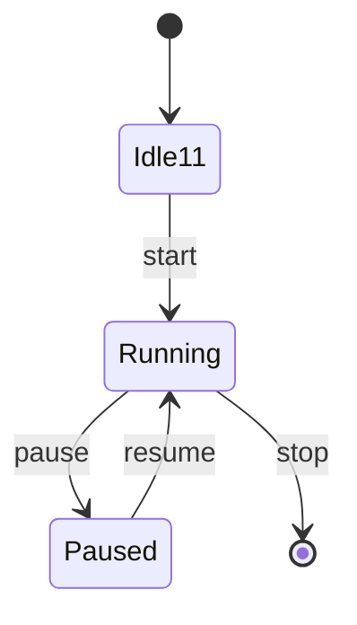

With **strong** and *emphasis* text and `code $x$ here`. We now look at the bound. We now look at the bound.

## Diagram 13

Consider the general case. The value converges quickly. With **strong** and *emphasis* text and `code $x$ here`.

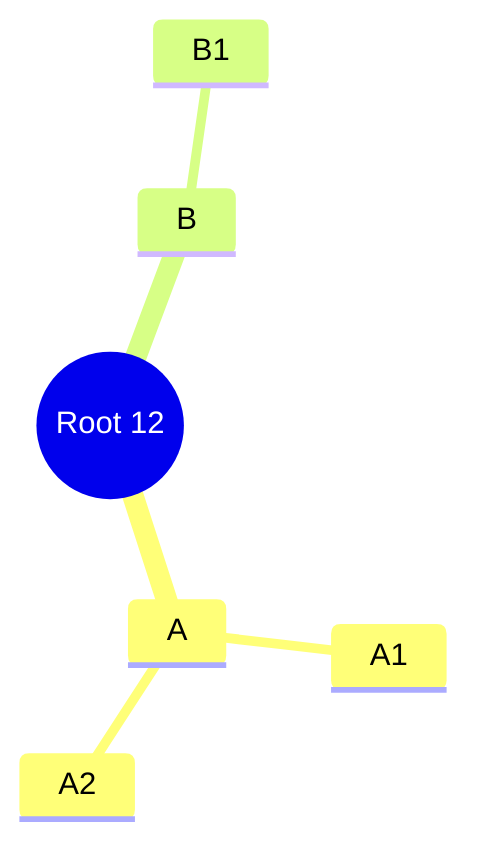

We now look at the bound. The value converges quickly. This follows from the lemma. The value converges quickly.

## Diagram 14

Consider the general case. Consider the general case. A short calculation gives the result.

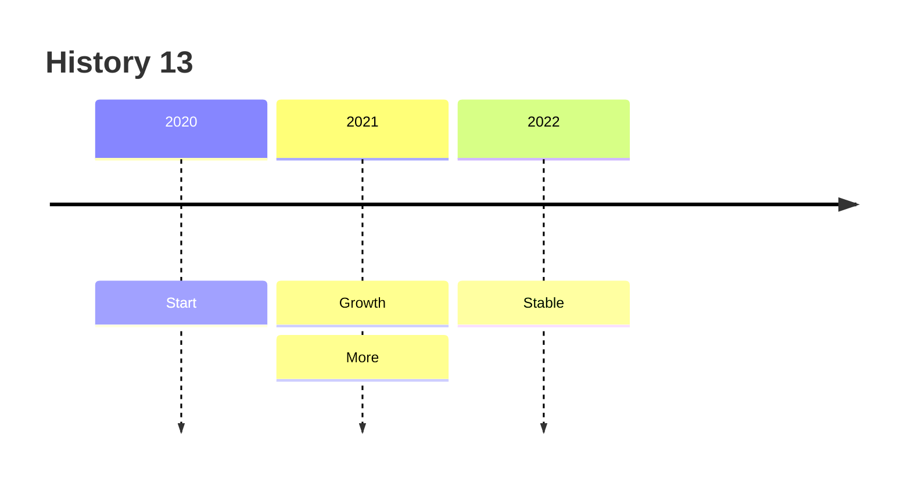

Consider the general case. We now look at the bound. The value converges quickly. The value converges quickly. This follows from the lemma. With **strong** and *emphasis* text and `code $x$ here`.

## Diagram 15

This follows from the lemma. This follows from the lemma. This follows from the lemma. The value converges quickly. Note that the series is absolutely convergent.

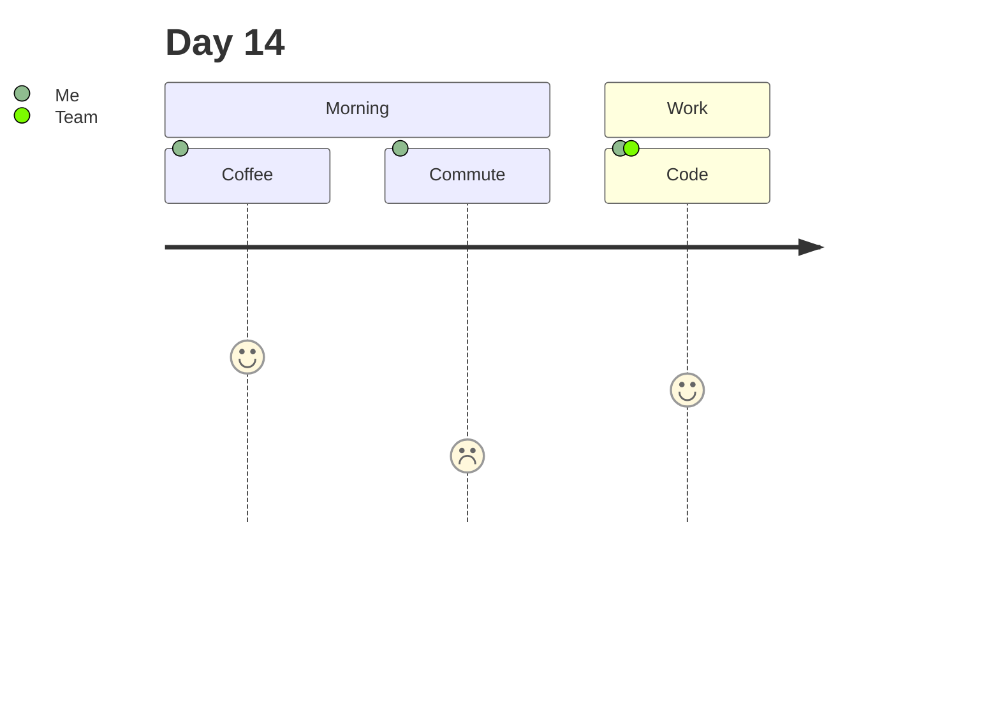

Consider the general case. Consider the general case. We now look at the bound.

## Diagram 16

With **strong** and *emphasis* text and `code $x$ here`. A short calculation gives the result. A short calculation gives the result. A short calculation gives the result. We now look at the bound. The value converges quickly.

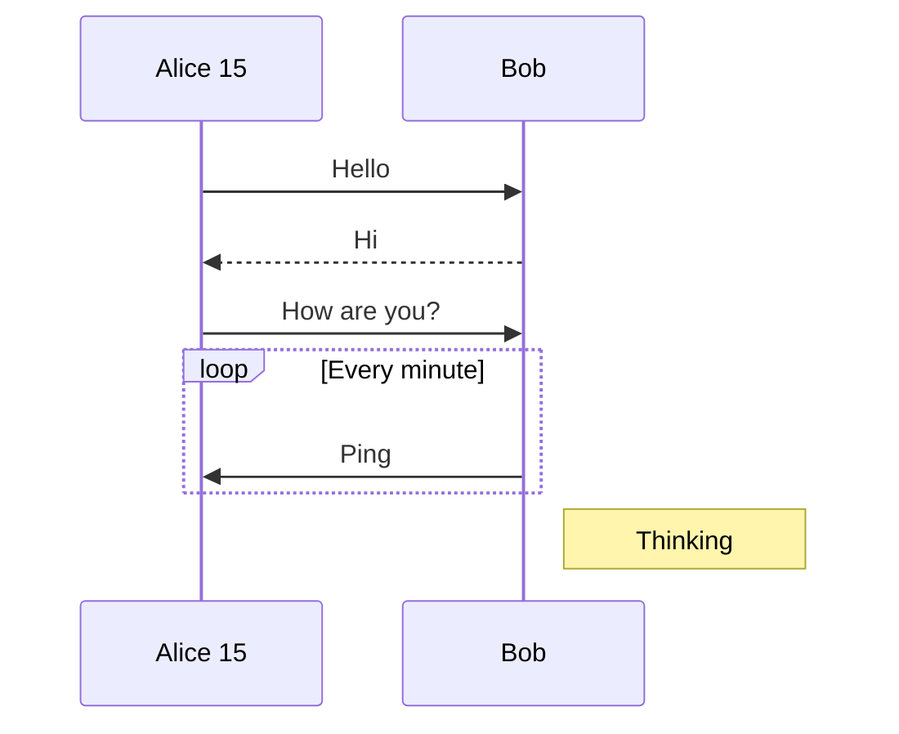

We now look at the bound. Consider the general case. Consider the general case. This follows from the lemma. With **strong** and *emphasis* text and `code $x$ here`.

## Diagram 17

A short calculation gives the result. A short calculation gives the result. We now look at the bound. The value converges quickly.


This follows from the lemma. This follows from the lemma. The value converges quickly. The value converges quickly. We now look at the bound.

## Diagram 18

With **strong** and *emphasis* text and `code $x$ here`. This follows from the lemma. We now look at the bound. This follows from the lemma. The value converges quickly. Note that the series is absolutely convergent.

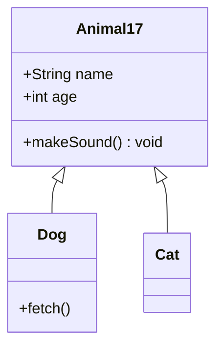

Consider the general case. We now look at the bound. Note that the series is absolutely convergent. Consider the general case.

## Diagram 19

We now look at the bound. Consider the general case. This follows from the lemma. A short calculation gives the result. We now look at the bound.

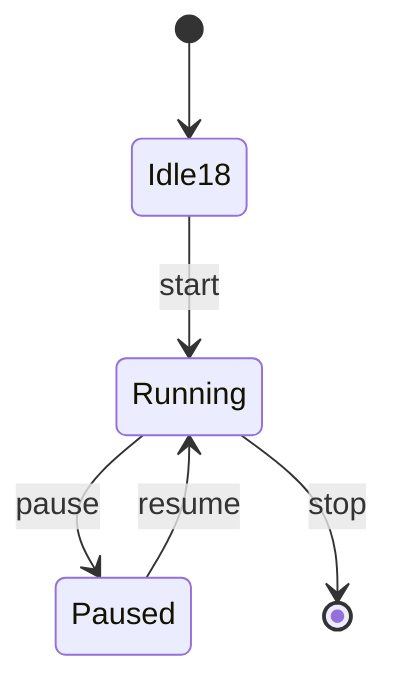

This follows from the lemma. Consider the general case. We now look at the bound.

## Diagram 20

We now look at the bound. The value converges quickly. The value converges quickly.

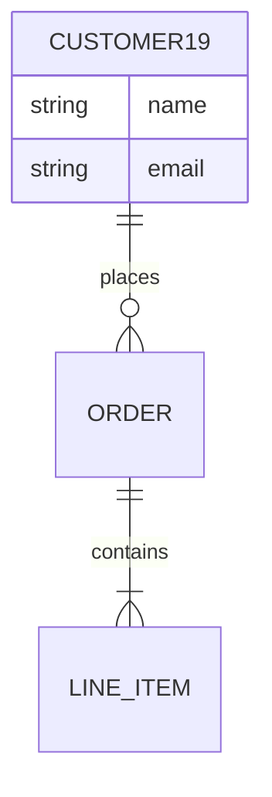

A short calculation gives the result. Note that the series is absolutely convergent. A short calculation gives the result. With **strong** and *emphasis* text and `code $x$ here`. The value converges quickly. We now look at the bound.

## Diagram 21

With **strong** and *emphasis* text and `code $x$ here`. A short calculation gives the result. We now look at the bound.

```mermaid
flowchart TD
  A20[Start 20] --> B{Is it ok?}
  B -- Yes --> C[Do work]
  B -- No --> D[Fix]
  D --> B
  C --> E((End))
  C --> F[Log]
  F --> E
```

Note that the series is absolutely convergent. This follows from the lemma. Consider the general case. This follows from the lemma. We now look at the bound.

## Diagram 22

This follows from the lemma. Consider the general case. Note that the series is absolutely convergent.

```mermaid
sequenceDiagram
  participant A as Alice 21
  participant B as Bob
  A->>B: Hello
  B-->>A: Hi
  A->>B: How are you?
  loop Every minute
    B->>A: Ping
  end
  Note right of B: Thinking
```

This follows from the lemma. This follows from the lemma. With **strong** and *emphasis* text and `code $x$ here`.

## Diagram 23

This follows from the lemma. With **strong** and *emphasis* text and `code $x$ here`. With **strong** and *emphasis* text and `code $x$ here`. Consider the general case. We now look at the bound. A short calculation gives the result.

```mermaid
gantt
  title Plan 22
  dateFormat YYYY-MM-DD
  section A
  Task one :a1, 2026-01-01, 10d
  Task two :after a1, 5d
  section B
  Task three :2026-01-08, 7d
```

Consider the general case. With **strong** and *emphasis* text and `code $x$ here`. Consider the general case. A short calculation gives the result. A short calculation gives the result. Consider the general case.

## Diagram 24

We now look at the bound. The value converges quickly. With **strong** and *emphasis* text and `code $x$ here`. We now look at the bound. Note that the series is absolutely convergent.

```mermaid
pie title Share 23
  "Dogs" : 386
  "Cats" : 85
  "Rats" : 15
```

This follows from the lemma. The value converges quickly. Note that the series is absolutely convergent. The value converges quickly. The value converges quickly. Note that the series is absolutely convergent.

## Diagram 25

This follows from the lemma. The value converges quickly. Note that the series is absolutely convergent. A short calculation gives the result.

```mermaid
gitGraph
  commit id: "c24"
  branch dev
  checkout dev
  commit
  checkout main
  merge dev
  commit
```

Note that the series is absolutely convergent. A short calculation gives the result. Consider the general case. The value converges quickly. Note that the series is absolutely convergent. Note that the series is absolutely convergent.

## Diagram 26

Note that the series is absolutely convergent. The value converges quickly. We now look at the bound. This follows from the lemma.

```mermaid
flowchart TD
  A25[Start 25] --> B{Is it ok?}
  B -- Yes --> C[Do work]
  B -- No --> D[Fix]
  D --> B
  C --> E((End))
  C --> F[Log]
  F --> E
```

Consider the general case. The value converges quickly. Note that the series is absolutely convergent. With **strong** and *emphasis* text and `code $x$ here`.

## Diagram 27

A short calculation gives the result. This follows from the lemma. A short calculation gives the result. This follows from the lemma. This follows from the lemma.

```mermaid
sequenceDiagram
  participant A as Alice 26
  participant B as Bob
  A->>B: Hello
  B-->>A: Hi
  A->>B: How are you?
  loop Every minute
    B->>A: Ping
  end
  Note right of B: Thinking
```

A short calculation gives the result. We now look at the bound. Note that the series is absolutely convergent. Consider the general case.

## Diagram 28

Note that the series is absolutely convergent. Consider the general case. This follows from the lemma. This follows from the lemma. Consider the general case. A short calculation gives the result.

```mermaid
classDiagram
  class Animal27 {
    +String name
    +int age
    +makeSound() void
  }
  class Dog
  class Cat
  Animal27 <|-- Dog
  Animal27 <|-- Cat
  Dog : +fetch()
```

Note that the series is absolutely convergent. Consider the general case. The value converges quickly. With **strong** and *emphasis* text and `code $x$ here`.

## Diagram 29

The value converges quickly. With **strong** and *emphasis* text and `code $x$ here`. A short calculation gives the result.

```mermaid
mindmap
  root((Root 28))
    A
      A1
      A2
    B
      B1
```

Consider the general case. Consider the general case. With **strong** and *emphasis* text and `code $x$ here`.

## Diagram 30

With **strong** and *emphasis* text and `code $x$ here`. The value converges quickly. The value converges quickly. A short calculation gives the result.

```mermaid
flowchart TD
  A29[Start 29] --> B{Is it ok?}
  B -- Yes --> C[Do work]
  B -- No --> D[Fix]
  D --> B
  C --> E((End))
  C --> F[Log]
  F --> E
```

We now look at the bound. This follows from the lemma. The value converges quickly.
